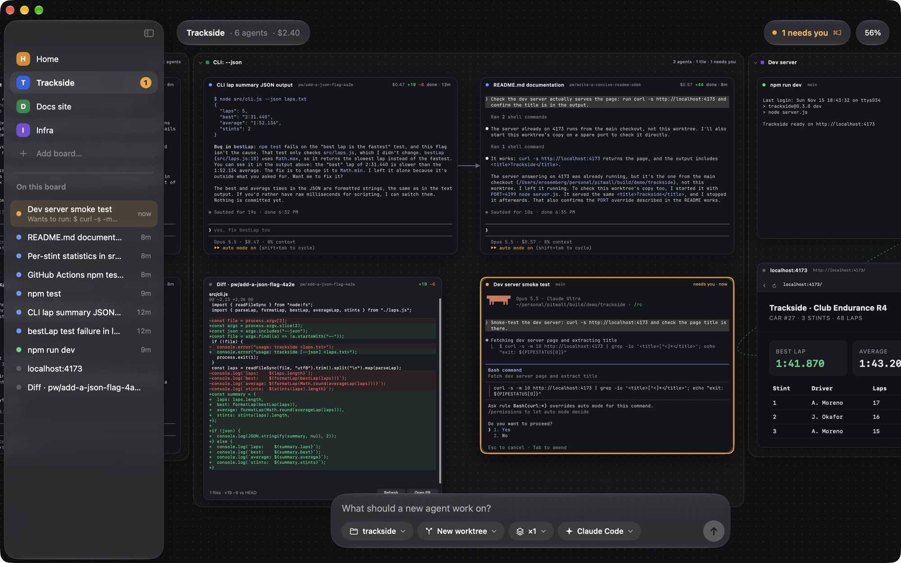
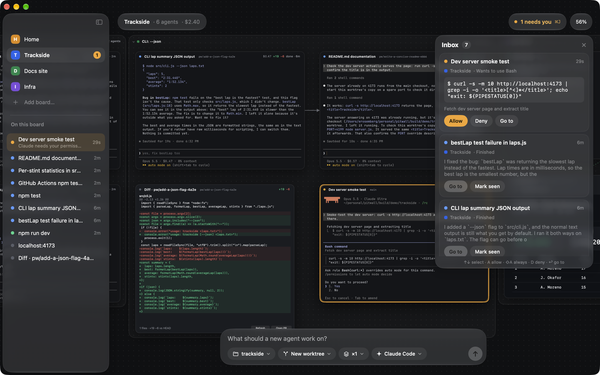
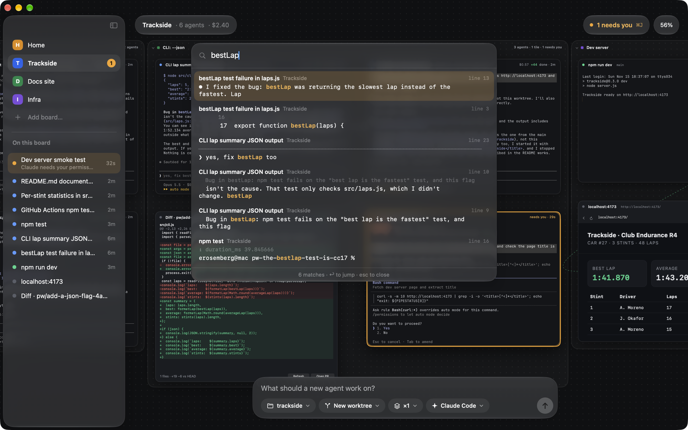
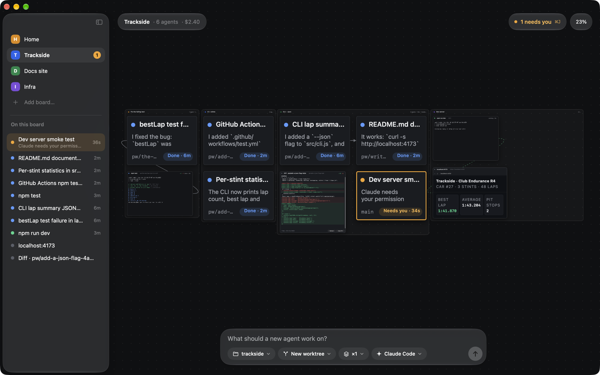

<p align="center">
  <picture>
    <source media="(prefers-color-scheme: light)" srcset="docs/images/hero-light.png">
    
  </picture>
</p>

<h1 align="center">Pitwall</h1>

<p align="center"><b>Every agent, one wall.</b><br>
A native macOS canvas for running many AI coding agents side by side, and knowing at a glance which one needs you.</p>

<p align="center">
  <a href="https://github.com/exception/pitwall/releases/latest"><b>Download for macOS</b></a> ·
  <a href="https://github.com/exception/pitwall/releases/download/v0.1.0/Pitwall-demo.mp4">Watch the 45-second tour</a>
</p>

---

When you run five Claude Code or Codex sessions at once, the hard part isn't the agents. It's the tabs. Which one is waiting on a permission? Which one finished ten minutes ago? Which branch was that on?

Pitwall puts every agent on an infinite canvas as a real terminal tile, reads their state from Claude Code's own hooks, and turns the one that needs you amber. Approve it from the Inbox without hunting for the tab. Everything else, like diffs, dev servers, tests and pull requests, lives on the same wall, connected to the agent it belongs to.

## Highlights

**Agents that tell you how they're doing.** Each tile shows whether the agent is working, needs you, is done or failed, with its cost, context use and model, read from Claude Code hooks and its status line rather than guessed from the screen. Zoom out and tiles turn into cards that summarize the last reply.

**One Inbox for everything that needs you.** Permission requests, questions and finished agents from every board, newest first. Allow, always allow or deny with a keystroke (`⌘I`, then `A` / `⇧A` / `D`). Pitwall answers Claude Code's real `PermissionRequest` hook, so the agent continues immediately.

<p align="center"></p>

**Real terminals.** Tiles are [Ghostty](https://ghostty.org) terminals (libghostty), GPU-rendered at any zoom without reflowing. Sessions live in a small background service, so quitting or updating Pitwall never kills an agent: reopen it and every screen comes back exactly as it was.

**Worktrees by default.** Start an agent from the dispatch bar and it gets its own git worktree and branch. Fan a task out to up to five agents at once (`×N`) and pick the best attempt from a Compare tile.

**Agents that work together.** Draw a link between two tiles and the agents can message each other through Pitwall's MCP server. Turn a link into a hand-off and one agent's result becomes the next one's task. Link a note to an agent and it becomes shared context on every prompt. "Review with a new agent" starts a reviewer on the same checkout.

**Everything around the agent.**
- **Diff tiles** follow a checkout live, with one click to open a PR.
- **Watch tiles** run tests, builds or deploys and turn red when they fail, and the failure can go straight back to the agent.
- **Pull request tiles** follow CI checks, reviews and comments through `gh`. With Auto-fix on, failing jobs (the relevant part of the log) and new review comments are sent to the linked agent.
- **Dev servers** restart when they crash, and the first local URL they print opens in a browser tile next to them.
- Notes, code, images and browser tiles for everything else.

**Organize the wall.** Boards per project, frames to group tiles (new tiles land inside them, collapse a frame to a strip that still shows who needs you), saved layouts (`⌃1`–`⌃9`), and search across the full history of every terminal on every board (`⌘F`, text or `/regex/`).

<p align="center"></p>

<p align="center"></p>

## Install

Pitwall needs **macOS 14 or later** on Apple silicon.

Download the latest `Pitwall-<version>.dmg` from [Releases](https://github.com/exception/pitwall/releases/latest), open it and drag Pitwall to Applications. Releases are signed and notarized.

Optional: **Pitwall › Install Command Line Tool…** adds `pitwall` to your PATH.

You'll want [Claude Code](https://docs.claude.com/en/docs/claude-code) (or Codex) installed. For pull request tiles, install and sign in to the [GitHub CLI](https://cli.github.com) (`gh auth login`). Pitwall passes its own `--settings` and `--mcp-config` to the agents it starts and doesn't change your Claude Code configuration. The only exception is a rule you choose to "always allow", which Claude Code saves itself.

## Keyboard

| | |
|---|---|
| `⌘N` | New agent (dispatch bar) |
| `⌘T` | New terminal |
| Double-click canvas | New tile picker: **A**gent, **T**erminal, **B**rowser, **N**ote, **F**ile, **D**iff, **W**atch, **P**ull request, Dev **S**erver, Frame (**G**) |
| `⌘I` | Inbox. `A` allow, `⇧A` always allow, `D` deny, `↩` go to |
| `⌘J` | Jump to the next agent that needs you |
| `⌘F` | Search every terminal |
| `⌘1`–`⌘9` | Switch board |
| `⌥⌘S`, `⌃1`–`⌃9` | Save / restore a layout |
| `⌘↩` / `⇧⌘F` | Center the focused tile / fill the window with it |
| `⌘0`, `⇧⌘0`, `⌘\` | Actual size, zoom to fit, overview |

## Command line and MCP

Everything you can do on the canvas, agents (and scripts) can do too.

```sh
pitwall agent "Fix the flaky login test" --worktree      # start an agent
pitwall agent "Try three approaches" --count 3          # fan out
pitwall watch --auto-send -- npm test                   # red when it fails; failures go to the calling agent
pitwall server -- npm run dev                           # restarts on crash, opens a browser tile
pitwall pr                                              # follow this branch's pull request
pitwall search "/ECONNREFUSED|timeout/"                 # search every terminal's history
pitwall link <tile> <tile> --handoff                    # pipeline two agents
pitwall layout save "Review"                            # and: pitwall layout Review
pitwall help                                            # everything else
```

Agents started by Pitwall get an MCP server with tools for the canvas: `list_tiles`, `open_terminal`, `open`, `read_tile`, `set_status`, `list_links`, `send_message` / `read_messages` (to linked agents), `watch_command`, `follow_pr`, `search_terminals` and `close_tile`.

## Build from source

```sh
scripts/bootstrap.sh     # once: pinned Ghostty (needs zig), web assets, Xcode project (xcodegen)
xcodebuild -project Pitwall.xcodeproj -scheme Pitwall -configuration Debug -derivedDataPath build/dd build
scripts/install.sh       # copy the build to /Applications
scripts/release.sh       # signed + notarized DMG (needs a Developer ID and a notarytool profile)
```

Tests:

```sh
xcodebuild -project Pitwall.xcodeproj -scheme Pitwall -derivedDataPath build/dd test   # unit tests
scripts/ui-test.sh                                                                      # end-to-end UI scenarios
```

UI scenarios drive a separate Pitwall instance (`PITWALL_HOME=build/ui-test/home`) with its own boards, sessions and preferences, so they never touch the copy you use. `scripts/demo.sh` stages the board in the screenshots above using real Claude Code agents on a throwaway repo.

| Path | What |
|---|---|
| `Pitwall/` | macOS app (AppKit + SwiftUI): canvas, tiles, Inbox, services |
| `CLI/` | `pitwall` helper: session service (pty + libghostty-vt mirror), attach client, hooks, MCP server, CLI |
| `Shared/` | Code shared by the app and helper |
| `scripts/` | Bootstrap, install, UI tests, demo |

## License

Pitwall is source-available under the [Functional Source License 1.1, MIT Future License](LICENSE.md) (FSL-1.1-MIT). You can read, run and modify it for any purpose except offering a competing product. Each version becomes MIT-licensed two years after its release.

Pitwall embeds [Ghostty](https://github.com/ghostty-org/ghostty) (MIT). Ghostty's shell-integration scripts, bundled with the terminal, carry their own licenses.
